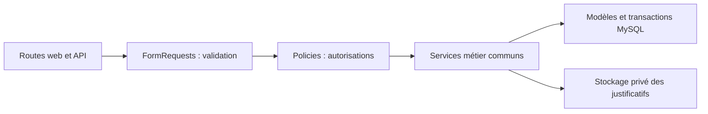

# Revue d’architecture et corrections — 13 octobre 2026

## Verdict

Le monolithe Laravel MVC est adapté à cette application de gestion de dépenses. Il n’est pas nécessaire d’ajouter des microservices. Les modèles, migrations, rôles et routes constituent une base cohérente. En revanche, les contrôleurs web et API dupliquaient les règles métier et produisaient des comportements différents. Les factures multi-articles, les autorisations, le calcul des montants et le stockage des justificatifs comportaient des défauts confirmés.

Les corrections donnent au web et à l’API le même chemin de validation et de traitement :

`DepenseService` porte les créations, modifications et transitions de statut avec verrouillage transactionnel. `ExpenseReportingService` regroupe les dépenses historiques et les lignes de factures pour les rapports. Les contrôleurs restent responsables de la réponse HTTP. `Amount` centralise les calculs décimaux.

## Défauts corrigés

| Domaine | Problème confirmé | Correction |
| --- | --- | --- |
| Autorisations | Différences web/API, accès à des chantiers non affectés, actions de validation hors étape | Policies communes, périmètre des requêtes, contrôle des comptes actifs et transitions vérifiées dans les transactions |
| Factures | Champs historiques obligatoires incompatibles avec les lignes, édition incomplète, perte des saisies après erreur | Migrations additives, parcours multi-articles commun, restauration des champs et lignes |
| Montants | Arrondis flottants, prix nul mal recalculé, totaux incohérents | BCMath, arrondi au centime, limites correspondant aux colonnes SQL, recalcul transactionnel |
| Rapports | Lignes absentes des catégories, doubles comptes possibles, statistiques limitées à une page | Agrégations des lignes et dépenses historiques, comptage distinct des factures, statistiques sur la requête complète |
| Documents | Justificatifs accessibles publiquement | Nouveaux fichiers privés, téléchargement autorisé, commande vérifiée de migration des anciens fichiers |
| Données | Affectations répétées, mauvaises références de tables, seeders destructifs | Affectation sans doublon, CRUD corrigé, seeders idempotents, références stables |
| Connexion | Comptes inactifs et entrées malformées mal gérés | Blocage des comptes inactifs, validation et limitation des tentatives |
| Exports | Ancienne bibliothèque Excel incompatible, cellules pouvant être interprétées comme formules | XLSX OpenXML valide avec texte littéral, CSV protégé |
| Interface | Dépendances CDN, erreurs du tableau de bord chef, débordements et visualiseur non accessible au clavier | Assets locaux, jointure qualifiée, mise en page responsive, focus du dialogue et raccourcis clavier |
| Dépendances | Versions présentant des avis de sécurité connus | Laravel 12, Sanctum 4, Vite 7, Tailwind 4 et lockfiles actualisés |
| Docker | Secrets incorporés, volume masquant le code, permissions de stockage et limites upload incohérentes | Secrets injectés à l’exécution, images applicative/web cohérentes, volume limité au stockage, droits et limites harmonisés |

Les montants agrégés sont renvoyés sous forme de chaînes décimales exactes. Les consommateurs API doivent éviter leur conversion en flottants pour les calculs financiers. L’API dispose désormais de l’étape d’approbation du directeur avant la validation comptable.

## Vérifications effectuées

- 66 tests PHP réussis, 303 assertions, sur une base MySQL de tests séparée : autorisations, montants, états, rapports, fichiers, exports, CRUD et cas de régression.
- Installation Composer depuis le lockfile, validation du manifest et exigences de plateforme réussies.
- Compilation Vite réussie ; `npm audit` : zéro vulnérabilité signalée.
- Parcours réel Chromium : création, reprise après erreur de validation, PDF de plus de 3 Mo, ouverture au clavier, édition, rejet motivé par le directeur, correction et nouvelle soumission, nouvelle approbation et validation comptable. Aucune erreur de console ou de chargement d’assets dans ces parcours.
- Formulaire vérifié à 320, 768, 1024 et 1440 px sans débordement horizontal.
- Migrations appliquées sur les bases locales ; commande de protection des fichiers testée, y compris les fichiers manquants et collisions.
- Syntaxe Compose et script d’entrée Docker vérifiés. Les images de production n’ont pas été construites ni déployées dans cette revue.

L’audit Composer officiel reste bloqué par la politique réseau sur `packagist.org`. Une vérification de secours du lockfile contre FriendsOfPHP/security-advisories, commit `7121e12a81638ca429afcee31150dfa519fcd871`, a examiné 122 packages et 88 avis pertinents : aucune correspondance restante et aucune erreur de lecture. Cette vérification ne remplace pas l’audit officiel complet. L’autorisation du domaine est proposée dans le brouillon cloud, sans application automatique.

## Points à valider avant production

Sauvegarder MySQL et les fichiers, conserver une clé Laravel stable et suivre le README pour la migration des volumes. Les justificatifs publics existants doivent être protégés avec `justificatifs:protect` ; les fichiers absents ou conflictuels demandent une restauration ou une résolution manuelle, sans écrasement automatique.

Le service Nginx Compose écoute en HTTP sur loopback : un proxy HTTPS est nécessaire. Renseigner uniquement les adresses des proxies de confiance dans `TRUSTED_PROXIES`, puis vérifier connexion, cookies sécurisés, URLs et uploads derrière le proxy réel. Construire et tester les images de production en préproduction avant déploiement.

Des composants Vue historiques restent présents alors que les écrans principaux utilisent Blade/Alpine. Leur suppression éventuelle et le regroupement des écrans d’édition constituent une amélioration de maintenance ultérieure. La revue et les tests couvrent les défauts identifiés ; ils ne garantissent pas l’absence de tout autre défaut ni la tenue en charge.
